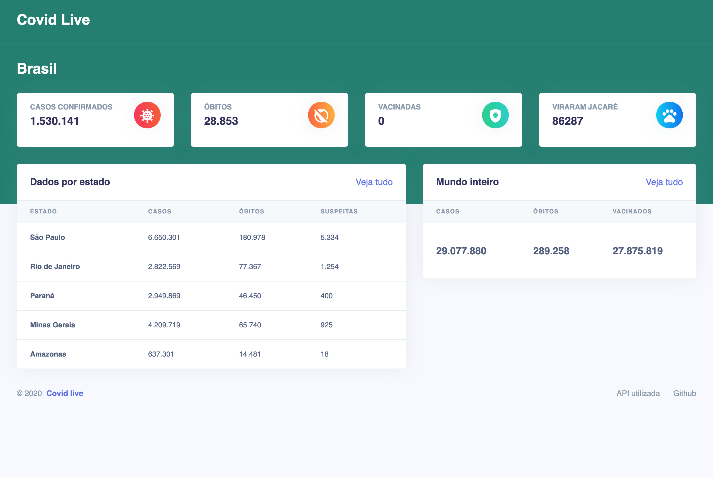
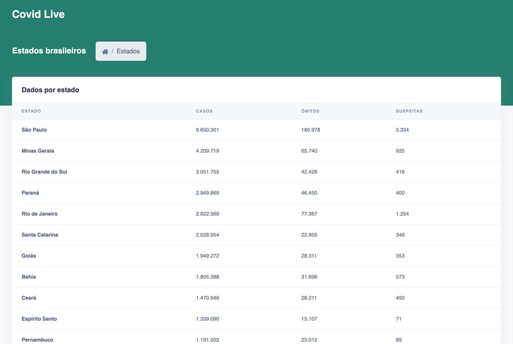
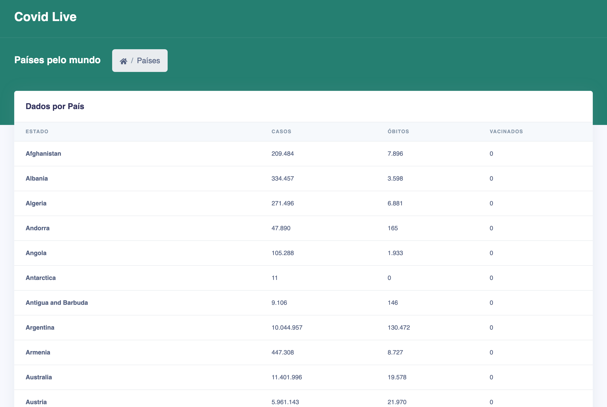

<h1 align="center">covid live</h1>

<p align="center">
  a real-time covid-19 dashboard for brazil and the world.<br>
  built and shipped by me while people were checking the numbers every day.
</p>

<p align="center"></p>

### what it did

- **brazil at a glance** · confirmed cases, deaths and recoveries, updated on every visit
- **state by state** · every brazilian state ranked by cases, with deaths and suspected cases
- **the world** · global totals plus a country-by-country table
- server-side rendered, so every page load fetched fresh numbers

<p align="center">
  
  &nbsp;
  
</p>

### stack

`next.js` · `typescript` · `styled-components` · `react-countup` · deployed on `vercel`

data from [covid19-brazil-api](https://github.com/devarthurribeiro/covid19-brazil-api) and [disease.sh](https://disease.sh).
the original world API (covid19api.com) was shut down in 2023, so it was swapped for disease.sh to keep the project running.

### run it

```sh
yarn
yarn dev   # node 16
```

<sub>archived. kept here as a piece of history, not maintained.</sub>
